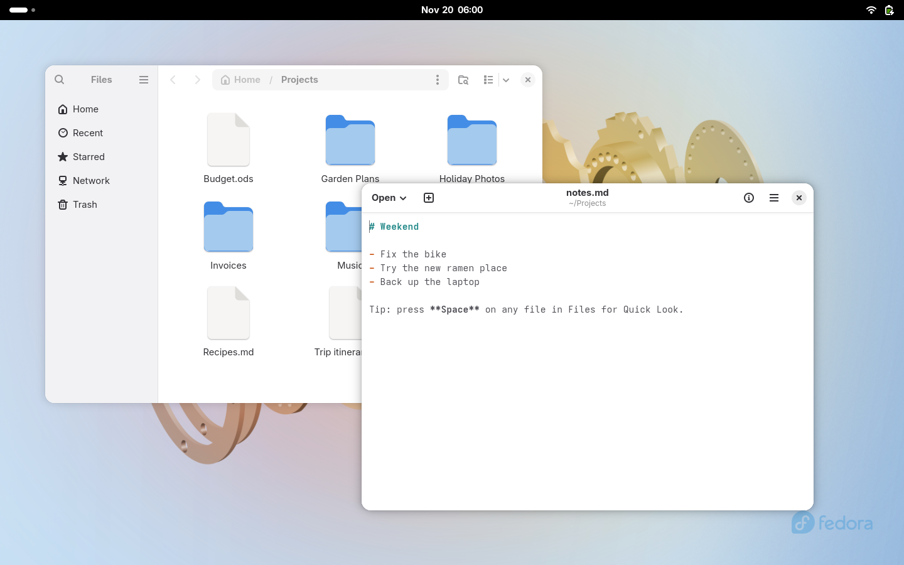
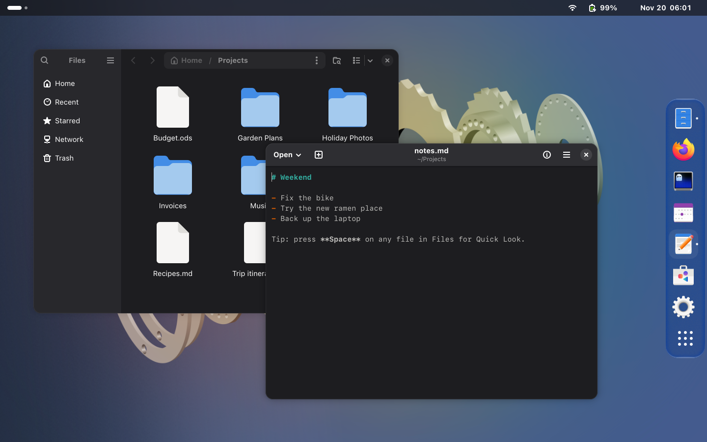
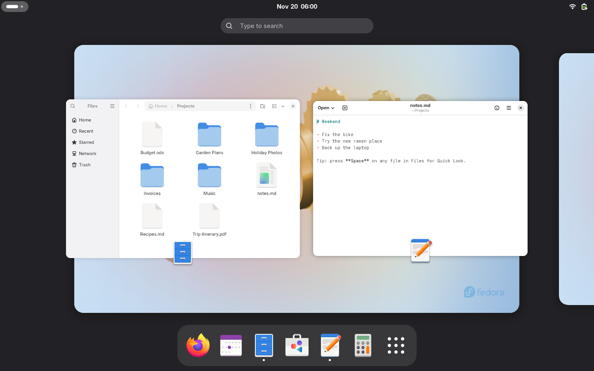
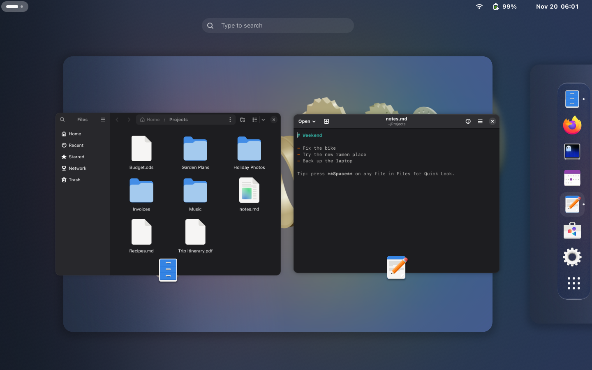

# Fedora for Mac people

**A guide (and an optional setup script) for making Fedora GNOME look and feel like macOS.**

I moved from a MacBook to a Linux laptop and wanted the parts of the Mac I actually use every day: Cmd shortcuts that work everywhere, a dock, Quick Look, a menu bar with room to breathe, Magic Mouse gestures, and no surprises. GNOME is already the closest Linux desktop to macOS. It takes about a dozen changes to close most of the remaining gap, and several days of trial and error to find which ones. This repo is the short version.

| Stock Fedora 45 | After this guide |
|---|---|
|  |  |
|  |  |

Tested on Fedora 45 Workstation (GNOME 51, Wayland). Most of it applies to any recent GNOME.

## What you get

- **Cmd works like Cmd.** Cmd+C, Cmd+Tab, Cmd+Q, Cmd+Space, word jumps with Option+arrows, in every app including terminals.
- **A Mac-style dock** with blurred glass, running-app dots, and Cmd+Option+D to toggle auto-hide.
- **A roomier top bar** with the clock on the right, after the status icons, like the menu bar.
- **San Francisco fonts and the macOS cursor.**
- **Dark mode everywhere,** including older GTK3 apps that ignore GNOME's setting.
- **Quick Look:** press Space on a file in Files.
- **Genie-style minimise.**
- **Magic Mouse gestures** with smooth momentum scrolling.
- **Mac habits:** tap-to-click off, natural scrolling, hot corners off.

## Quick start

```sh
git clone https://github.com/jasperblues/fedora-for-mac-people.git
cd fedora-for-mac-people
./setup.sh
```

The script asks before each step, can be run again safely, and only uses `sudo` for `dnf install`. Afterwards, **log out and back in**: GNOME on Wayland only discovers new extensions at login. Then install Toshy (below), which has its own installer.

If you'd rather do it by hand, or want to know what the script changes, the rest of this README covers each piece.

## 1. Keyboard: Toshy

[Toshy](https://github.com/RedBearAK/toshy) remaps the keyboard so Cmd (the Alt key position on a PC keyboard, or Cmd on an Apple keyboard) does what it does on a Mac, with per-app rules for terminals, browsers and file managers. It's the most important piece in this guide.

```sh
git clone https://github.com/RedBearAK/toshy.git ~/toshy
cd ~/toshy && ./setup_toshy.py install
```

- On GNOME Wayland Toshy needs an extension to know which window has focus. This guide uses [Focused Window D-Bus](https://extensions.gnome.org/extension/5592/focused-window-d-bus/), and `setup.sh` installs it.
- Toshy's GNOME tweaks move the overview shortcut to Shift+Ctrl+Space, so **Cmd+Space opens search like Spotlight.** `settings/mac-like.dconf` also stops the Super key opening the overview on its own, because on a Mac keyboard that key is Cmd.
- Apple keyboards in Mac mode are detected automatically. A Bluetooth keyboard that reports itself as a PC keyboard can be added to `kbtype_override` in `~/.config/toshy/toshy_config.py`.

[`extras/toshy-user-keymaps.py`](extras/toshy-user-keymaps.py) has a few additions to paste into the `user_apps` section of your Toshy config:

- **Cmd+W closes GNOME Software and Settings,** which ignore Ctrl+W.
- **Cmd+V pastes images in terminals,** for tools such as Claude Code that read images from the clipboard.

## 2. Dock: Dash to Dock + Blur my Shell

```sh
sudo dnf install gnome-shell-extension-dash-to-dock
```

The dock sits on the right, always visible, with 48px icons, a dot under running apps, and no trash or drive icons. Clicking an app with several windows shows previews. Change `dock-position` to `'BOTTOM'` in [`settings/mac-like.dconf`](settings/mac-like.dconf) if you like it at the bottom.

**Cmd+Option+D toggles auto-hide**, as on the Mac. [`extras/toggle-dock-autohide`](extras/toggle-dock-autohide) flips the dock between always shown and auto-hide, and `setup.sh` binds it to Ctrl+Alt+D, which is what Cmd+Option+D sends once Toshy is running.

**Glass:** [Blur my Shell](https://extensions.gnome.org/extension/3193/blur-my-shell/) gives the dock a frosted-glass look ("Liquid Frost": light blur, slight refraction at the edges, a little noise) and blurs the top bar.

> **Install Blur my Shell from extensions.gnome.org, not dnf.** Fedora 45's `gnome-shell-extension-blur-my-shell` (version 75) is missing its `styles/` folder, so the panel and dock never become transparent. `setup.sh` installs the extensions.gnome.org build into `~/.local`.

## 3. Top bar: Roomy Panel

[Roomy Panel](https://github.com/jasperblues/gnome-roomy-panel) adds macOS-style spacing between the status icons. It also moves the clock to the far right, which stops GNOME from cutting off the battery percentage when the bar gets crowded. The battery percentage is turned on too.

## 4. Fonts and cursor

**Fonts.** The interface uses SF Pro Text 11, window titles SF Pro Text Bold 11, and terminals and code SF Mono 11.
- Apple's fonts are a free download from [developer.apple.com/fonts](https://developer.apple.com/fonts/). You can also copy them from a Mac's `/Library/Fonts` and `/System/Library/Fonts`. Put them in `~/.local/share/fonts/` and run `fc-cache -f`.
- Apple's licence is written for designing apps for Apple platforms, so decide for yourself whether you're comfortable using them on Linux.
- If SF Pro isn't installed, `setup.sh` uses [Inter](https://rsms.me/inter/) and JetBrains Mono instead (both open source, in dnf). Inter was designed in a very similar style to SF.

**Cursor.** The [apple_cursor](https://github.com/ful1e5/apple_cursor) theme (`macOS`) goes in `~/.local/share/icons/`.

> In Settings and Tweaks, choose **macOS** as the *cursor* theme, never as the *icon* theme: it only contains cursors, so app icons would break. Keep the icon theme on Adwaita.

## 5. Dark mode everywhere

The settings turn on dark style with the blue accent. Older GTK3 apps don't follow GNOME's dark style by themselves, so they need two extra steps:

```sh
sudo dnf install adw-gtk3-theme
gsettings set org.gnome.desktop.interface gtk-theme 'adw-gtk3-dark'
printf '[Settings]\ngtk-application-prefer-dark-theme=1\n' >> ~/.config/gtk-3.0/settings.ini
```

(`Adwaita-dark` doesn't exist on Fedora 45, so setting that silently gives you light GTK3 apps.)

## 6. Files and Quick Look

```sh
sudo dnf install sushi
```

[Sushi](https://gitlab.gnome.org/GNOME/sushi) previews files in Files when you press **Space**, with arrow keys moving to the next file, like Quick Look.

## 7. Genie minimise

[Compiz alike magic lamp effect](https://extensions.gnome.org/extension/3740/compiz-alike-magic-lamp-effect/) minimises windows into the dock with a genie animation. It's set to 300ms, a little quicker than the default, which keeps it subtle.

## 8. Mouse and touchpad

- **Magic Mouse:** [magic-mouse-gestures](https://github.com/jasperblues/magic-mouse-gestures) adds smooth one-finger scrolling with momentum, two-finger double-tap for the overview (Mission Control) and two-finger swipes between workspaces (Spaces). Without it, a Magic Mouse on Linux scrolls in jerky steps and has no gestures.
- **Touchpad:** tap-to-click off and two-finger scrolling on, as on a MacBook. Natural scrolling is GNOME's default for touchpads, and the settings turn it on for mice too.
- **Hot corners off**, so moving the pointer into the top-left corner doesn't open the overview.

## Optional extras

- [**Polite Focus**](https://github.com/jasperblues/gnome-polite-focus): on macOS, a window that wants your attention comes to the front. GNOME shows an "is ready" notification instead. This extension brings the window forward, and lets you mute apps that ask for attention too often.
- [**Thunderbird Mac style**](https://github.com/jasperblues/thunderbird-mac-style): makes Thunderbird look like a Mac mail client.
- [**Headroom**](https://github.com/jasperblues/gnome-headroom): AI plan limits and token usage in the top bar, for people who use Claude Code or Codex.
- [**LG UltraFine watchdog**](https://github.com/jasperblues/lg-ultrafine-watchdog): keeps an LG UltraFine 5K (the Apple-sold display) connected on laptops that drop the Thunderbolt link.
- **Firefox scroll speed:** GNOME has no touchpad scroll-speed setting (the gsettings key exists but is ignored). In Firefox, raise `apz.gtk.pangesture.pixel_delta_mode_multiplier` in `about:config` if scrolling feels slow.

## Gotchas we hit

- **New extensions need a logout on Wayland.** `gnome-extensions enable` won't find an extension installed in the current session.
- **Blur my Shell from dnf is broken** on Fedora 45 (see above).
- **GTK3 apps stay light** unless you use `adw-gtk3-dark` (see above).
- **The GRUB boot menu text is tiny on high-DPI screens,** and with Secure Boot on it can't be enlarged, because GRUB refuses to load fonts. The simplest fix is to keep the menu hidden (`sudo grub2-editenv - set menu_auto_hide=1`) and hold Shift at power-on when you need it.
- **Keep the macOS cursor theme out of the icon theme setting** (see above).

## Taking the screenshots yourself

`tools/shots.sh before` and `tools/shots.sh after` start a hidden, throwaway GNOME Shell with a fake home folder, open two demo windows and save the screenshots in `docs/img/`. "Before" is a completely stock session. "After" loads `settings/mac-like.dconf` plus the fonts, cursor and extensions from your `~/.local`. Your real session is never touched. Needs `sudo dnf install mutter-devkit`.

## Licence

MIT. The extensions and tools linked here have their own licences.
