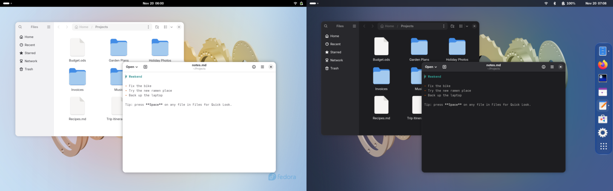

# I moved from a Mac to Linux, and made it feel like home

*November 2026*




For years my main computer was a Mac. This month I moved to a Linux laptop, and the reason was memory.

I've been running AI models locally: language models, image and video generation. For that, memory is what counts. The model has to fit, and the bigger ones need 60–100 GB. Apple Silicon handles this well, because the CPU and GPU share one big pool of memory, but Apple charges a lot for it.

Then AMD shipped the Ryzen AI Max+ 395 ("Strix Halo"), which takes the same approach: up to 128 GB of memory shared between the CPU and a capable built-in GPU. The ASUS ProArt PX13 puts that in a 13-inch convertible, and I bought the 128 GB model for **AU$5,999**. That's well under what Apple asks for a laptop with that much memory, and it runs models I couldn't run before.

It came with Windows, but I can't get along with its interface. So it was Linux, and the question became whether Linux could feel as good as my Mac. I expected to miss macOS. A week in, I don't, but only because I spent a few evenings sanding off the rough edges.

I've packaged everything up as **[Fedora for Mac people](https://github.com/jasperblues/fedora-for-mac-people)**: a guide, a setup script that asks before each step, and the screenshots above. Here is what mattered most, and what surprised me.

## The desktop: GNOME, not COSMIC

I started on Fedora's COSMIC edition because it looked fresh. It didn't last: scrolling had no momentum, and the small details weren't there yet. GNOME, on the other hand, already shares a lot of the Mac's thinking: one top bar, an overview a lot like Mission Control, apps that keep their settings simple. It needed adjusting, not replacing.

## The keyboard is everything

What makes a Mac feel like a Mac is that Cmd does the same thing everywhere. Cmd+C copies in the terminal too, Option+arrow jumps a word, Cmd+Q quits. On Linux, Ctrl does double duty, and muscle memory keeps tripping over it.

[Toshy](https://github.com/RedBearAK/toshy) fixes this completely. It remaps keys per app, so Cmd+C copies in a terminal and Ctrl+C still interrupts. I added two small rules of my own: Cmd+W closes GNOME's Settings and Software windows, and Cmd+V pastes screenshots into terminal tools like Claude Code.

## The look

- **Dock on the right** (Dash to Dock), with a frosted-glass background from Blur my Shell. I tuned a "Liquid Frost" effect: light blur, a little refraction at the edges, a touch of noise. Cmd+Option+D toggles auto-hide, as on the Mac.
- **The macOS cursor.** Small, but you notice it all day. I kept GNOME's own font: it's based on Inter, which already looks a lot like Apple's San Francisco (and Apple's fonts aren't licensed for Linux anyway).
- **A roomier top bar.** GNOME packs status icons 4px apart. I wrote a tiny extension, [Roomy Panel](https://github.com/jasperblues/gnome-roomy-panel), that spaces them out like the menu bar and moves the clock to the right.
- **Genie minimise**, a bit faster than the default so it stays subtle.
- **Dark mode everywhere**, including older GTK3 apps. That one took a while: the obvious theme name, `Adwaita-dark`, doesn't exist on Fedora 45, so those apps quietly stayed light.

## The Magic Mouse

On Linux the Magic Mouse scrolls in stuttering steps and has no gestures. So I wrote a [small daemon](https://github.com/jasperblues/magic-mouse-gestures) that reads the touch surface directly. It gives smooth scrolling with momentum, a two-finger double-tap for the overview and two-finger swipes between workspaces.

## The little things

- **Quick Look:** install `sushi`, then press Space on any file in Files.
- **Tap-to-click off**, so a palm on the touchpad doesn't click things.
- **Windows that need you come forward.** GNOME shows a notification saying an app "is ready" instead. [Polite Focus](https://github.com/jasperblues/gnome-polite-focus) brings the window to the front, and lets me mute the one app that kept doing it all day.

## What's still not quite there

- **GNOME has no touchpad scroll-speed setting.** The setting exists but is ignored. Firefox has its own setting in `about:config`.
- **The boot menu's text is tiny on a high-DPI screen,** and with Secure Boot on it can't be enlarged. I keep the menu hidden instead.
- **Fedora's packaged Blur my Shell is broken right now.** The extensions.gnome.org version works.

## Try it

```sh
git clone https://github.com/jasperblues/fedora-for-mac-people.git
cd fedora-for-mac-people && ./setup.sh
```

The script asks before each step, and the README explains every setting, so you can pick only what you want. If you're a Mac person thinking about Linux: it's closer than you think. It takes an afternoon, not a lifetime.
